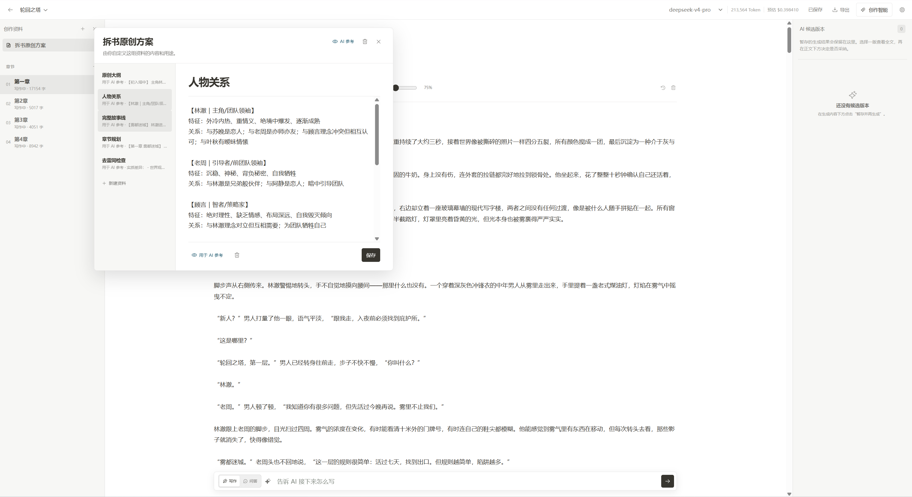
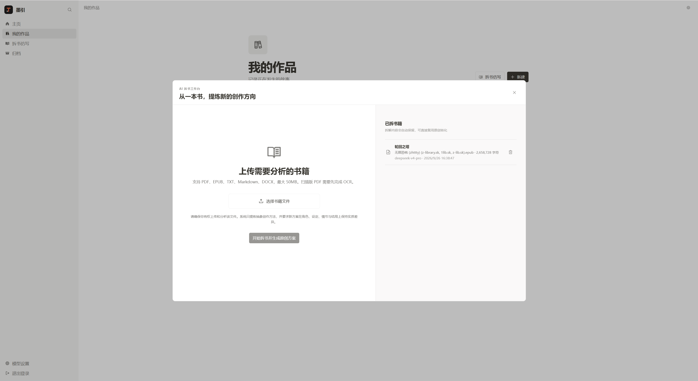
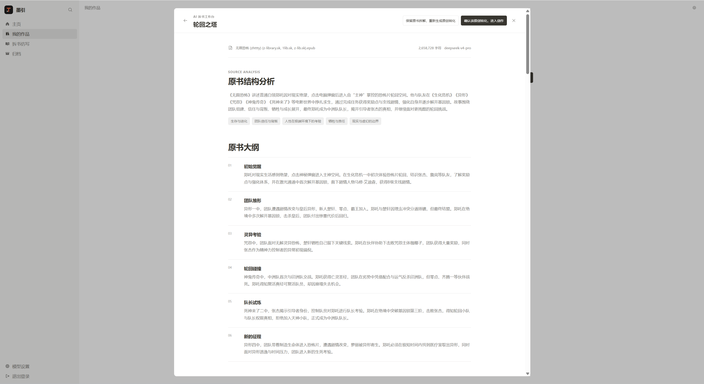
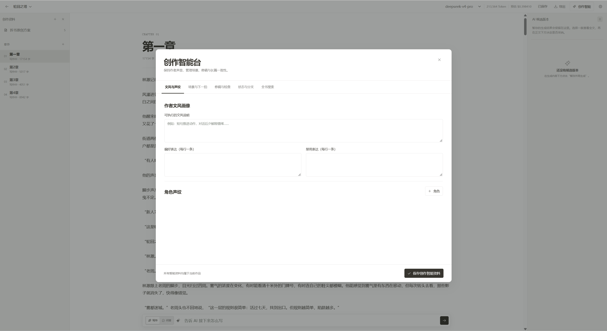
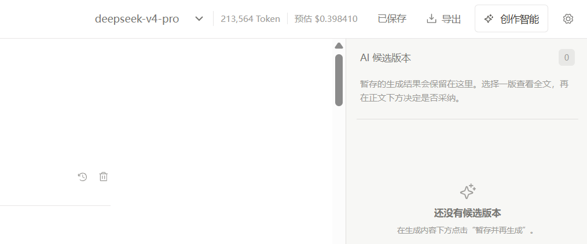

# text-creation-web

`text-creation-web` 是“墨引 · 小说创作助手”的浏览器端应用。墨引面向需要长期维护大纲、人物、设定和章节正文的个人小说作者，目标不是让 AI 取代作者，而是在不破坏原稿的前提下提供可控制、可预览、可追溯的写作辅助。

Web 是用户的主要创作空间，负责编辑体验、交互状态和离线草稿容灾。业务数据通过 Core API 保存，模型调用由 Core API 转发，浏览器不会获得模型 API Key。

## 界面示例

### 写作工作台

在同一个工作区内管理章节、正文、创作资料和 AI 候选版本；资料可以按需开启或关闭 AI 参考。



编辑器底部提供 AI 写作与问答入口，可结合当前章节内容继续创作或讨论情节。


### 拆书仿写

上传 PDF、EPUB、TXT、Markdown 或 DOCX 书稿，生成结构分析和原创创作方案。



分析结果展示原书结构、故事阶段和关键情节，确认后可继续生成原创方案并进入创作。



### 创作智能与模型配置

创作智能台用于维护作者文风、偏好与禁用表达、角色声纹，以及场景、修稿、一致性检查等辅助信息。



支持配置 OpenAI-compatible 写作模型；API Key 仅提交给 Core API 加密保存。


工作台顶部会显示当前模型、累计 Token 用量和预估费用，便于控制生成成本。



## 功能

### 账户与作品库

- 注册、登录和退出
- 作品创建、编辑、归档、恢复和删除
- 题材、篇幅、创作类型、笔风和一句话构想
- 外部书稿上传分析和原创方案生成

### 写作工作台

- TipTap/ProseMirror 正文编辑器
- 章节创建、切换、状态管理和删除
- 字数、预计阅读时间、字体、字号和版心宽度
- 自动保存和服务端版本提示
- IndexedDB 本地草稿、断网保留和联网重试
- 服务端/本地版本对比和手动合并
- 章节历史版本预览与恢复

### 创作资料

- 自定义资料分类和文字资料
- 分类级和单条资料的 AI 参考开关
- 资料创建、编辑、重命名和删除
- 展示每次 AI 生成实际引用的资料

### AI 写作

- SSE 流式续写和选区改写
- 写作模式和创作问答模式
- 停止、接受、丢弃、暂存和重新生成
- 多个候选版本切换
- 当前模型切换、Token 用量和费用估算
- 第三方模型数据发送范围提示

### 创作智能

- 作者文风画像、偏好表达和禁用表达
- 角色声纹和章节场景卡
- 情节“下一拍”规划
- AI 味扫描、自然度评分和修稿清单
- 文学编辑审阅、状态提取和一致性检查
- 剧情试写分支快照
- 全书正文与创作资料搜索

### 导出

- 当前章节 TXT
- 整部作品 TXT
- 整部作品 Markdown

## 架构

前端按业务能力组织：

```text
src/
├── app/                 # 应用壳、认证状态和页面切换
├── features/
│   ├── auth/            # 登录与注册
│   ├── projects/        # 作品库和书稿分析
│   ├── settings/        # 模型设置
│   └── workspace/       # 编辑器、章节、资料、AI 和创作智能
├── services/
│   ├── client/          # HTTP、OpenAPI、错误和 SSE
│   └── modules/         # 领域 API 客户端
├── storage/             # IndexedDB 本地草稿
├── shared/              # 公共 UI
├── types/               # 共享领域类型
└── styles/              # 设计变量和全局样式
```

运行时数据流：

```text
用户输入
   ▼
TipTap Editor ── 防抖 ── IndexedDB 草稿
   │                         │
   └──── 服务端保存成功后清理 ┘
   │ JSON / HttpOnly Session
   ▼
Core API ── PostgreSQL
   │
   └── AI Service ── Model Provider
          ▲
          └──── SSE 经 Core API 转发到 Web
```

核心原则：

- **编辑器优先**：AI 能力按需出现，不持续占据正文注意力。
- **建议不覆盖原稿**：AI 输出先预览，作者确认后才写入正文。
- **本地容灾**：每次编辑先保留浏览器草稿，网络失败不阻塞写作。
- **冲突可见**：版本变化时停止静默覆盖，让作者选择或合并。
- **数据访问集中**：功能组件统一通过 `services` 访问后端。
- **契约驱动**：普通接口使用 OpenAPI 类型，SSE 使用独立事件解析器。

## 关键流程

### 自动保存

1. 编辑器变化后更新字数并写入 IndexedDB。
2. 防抖结束后携带章节版本提交 Core API。
3. 保存成功后更新版本并清理本地草稿。
4. 网络失败保留草稿；版本冲突进入显式合并面板。

### AI 生成

1. 用户输入指令，或选中正文发起改写。
2. Web 提交操作类型、章节版本、选区和光标附近正文。
3. Core API 选择作品资料和创作智能上下文。
4. Web 消费 SSE，显示候选内容、引用资料和 Token 用量。
5. 作者接受、丢弃、暂存或重新生成。

## 技术栈

- React 19、TypeScript
- Vite
- TipTap / ProseMirror
- TanStack Query
- OpenAPI Fetch
- Dexie / IndexedDB
- Zustand
- Phosphor Icons
- Vitest、Testing Library、Playwright

## 本地启动

先启动 PostgreSQL、Core API 和 AI Service：

```powershell
cd D:\code\TextCreationAssistant\web
Copy-Item .env.example .env
pnpm install
pnpm dev
```

- Web：`http://localhost:5173`
- 默认 Core API：`http://localhost:3000`

如需修改 API 地址，请设置 `VITE_API_URL`。Core API 的 `WEB_ORIGIN` 必须与浏览器访问地址一致。

## API 类型更新

公共 OpenAPI 契约变化后执行：

```powershell
pnpm api:generate
pnpm typecheck
```

## 验证

```powershell
pnpm typecheck
pnpm test
pnpm test:e2e
pnpm build
```

首次运行端到端测试需安装 Chromium：

```powershell
pnpm exec playwright install chromium
```

## 隐私与安全

- 登录凭证使用 HttpOnly Session Cookie。
- 模型 API Key 只提交给 Core API 加密保存，不返回浏览器。
- AI 生成前会提示将发送给第三方服务商的正文与资料范围。
- IndexedDB 仅保存尚未同步的章节草稿，服务端保存成功后自动清理。

